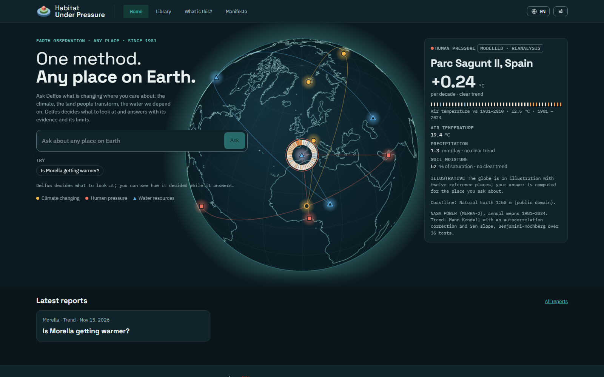
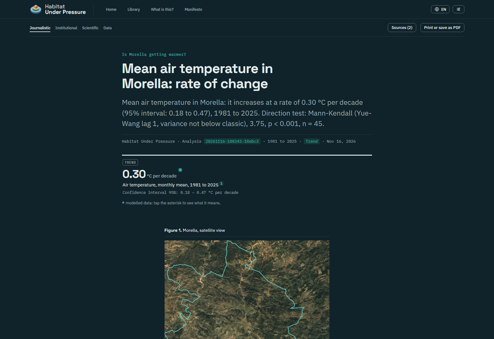
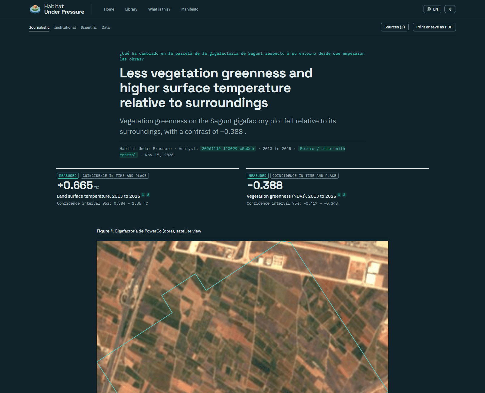

# Habitat Under Pressure


**NASA Space Apps Challenge 2026 · València · Challenge #02, “Be An Earth System Trend Detective!”**

Ask a question about any place on Earth and get an answer built from Earth observation data: what is changing
in the climate, in the land people transform and in the water we depend on. Every figure says where it comes
from, and every sentence says how far its evidence reaches.

Live demo: <https://hup-711350491618.europe-west1.run.app>

Promo video (30 seconds) and pitch deck (PDF, English and Spanish):
<https://drive.google.com/drive/folders/1nKLaXppCkk0NtVHP1669h_HefCfB-Acg>



## What it does

1. **You ask** in plain language, in English or Spanish: “Is Morella getting warmer?”, “How much night light
   was there in Xàtiva in October 2024?”
2. **Delfos, the engine, plans.** It resolves the place and turns the question into a plan over a closed
   catalogue of sources, variables and operations. Before running, the plan says whether the question can be
   answered in full, with limits, or not at all, and proposes the nearest question that can.
3. **The plan runs in view.** You see which sources are consulted and which steps are taken, including data
   being downloaded on demand.
4. **You read the answer** as an article with its main figure, the evidence behind it and what it does not
   say. The same analysis reads in three formats (journalistic, institutional and scientific), and its data
   open in a panel with series, maps and sources.
5. **It is saved.** Every analysis goes to a library with its question, plan, data and method, so anyone can
   open it again and check it.



*An answer computed by this repository's container with no key and no pre-downloaded data: NASA POWER air
temperature for Morella, 1981 to 2025. Satellite view: Sentinel-2 cloudless by EOX (contains modified
Copernicus Sentinel data 2016).*



*A before/after contrast against a control area, asked in Spanish about a construction site in Sagunt. Each
figure carries its interval, its class (measured) and its evidence level: a coincidence in time and place,
which the answer does not present as a cause.*

## The rules the code enforces

- **The language model writes no figures.** It is the voice that phrases the answer. Every number comes from
  a source and a saved calculation, and enters the text through a placeholder that code fills in.
- **A result carries data or an absence, never both.** An absence has a reason (no coverage, insufficient
  quality, source unreachable, package missing). It is never a zero or an invented value.
- **Every figure declares its kind:** measured, reanalysis, extrapolated, approximated or illustrative; with
  its unit, its period and its source.
- **Every sentence states how far its evidence goes,** on a ladder from E0 (described) to E5 (coherent chain
  of independent lines). No level allows causal language: a change that coincides with a project in time and
  place does not prove the project caused it.
- **The tool is universal.** No place has code or data prepared for it; what is stored for a place is stored
  by the application's own cache.

## Run it

You need Docker. From the repository root:

```bash
docker compose -f deploy/compose.yaml up --build -d
```

Then open <http://localhost:8080>.

It runs without any key or account. In that mode the assistant works from rules, answers are written from
templates, and sources that need an account or a pre-downloaded package return an explicit absence. To add a
language model or accounts, copy `.env.example` to `.env` and fill in what you have; `.env` is ignored by Git.

## Develop

Nothing is installed on the system: the Python environment lives inside the checkout.

```bash
python tools/setup_env.py
```

```bash
npm --prefix apps/web ci
```

Run the API on port 8000 and the web app on port 5173 (the dev server proxies `/api` to the API):

```bash
.venv/bin/python -m uvicorn hup_api.main:app --port 8000
```

```bash
npm --prefix apps/web run dev
```

On Windows the interpreter is `.venv\Scripts\python.exe`.

The single quality gate runs the contract validator, `ruff`, `pytest`, and in the web app `tsc`, `eslint` and
`vitest`:

```bash
python tools/gate.py
```

## Repository layout

| Path | Contents |
| --- | --- |
| `apps/api/` | FastAPI service: assistant, planner, executor, writer, reviewer, library and the LLM adapter |
| `apps/web/` | React and TypeScript web app: cover, plan, run, article, data panel, report and library |
| `packages/hup_data/` | Data layer: source readers, cache and manifest, place resolution, grids and masks |
| `packages/hup_ops/` | Analysis operations as pure functions: trends, anomalies, contrasts, extremes, scenarios |
| `catalog/` | The closed catalogue: sources, variables, operations, evidence chains, norms and report blocks |
| `docs/contratos/` | Exchange contracts v1.0 as JSON Schemas, with examples and a validator |
| `locales/` | Every visible string of the interface, in English and Spanish |
| `deploy/` | Dockerfile, local Compose file, and files for Google Cloud Run and for a single server |
| `tests/` | Gold tests against real-data values and the assistant test bench |
| `tools/` | Environment setup and the quality gate |
| `docs/img/` | Images of this README |
| `exploracion/` | Two reference files from the team's real-data probes, read by the trend tests |
| `.dev/skills/` | One-page project context for AI coding agents |

More detail: [architecture](docs/architecture.md), [exchange contracts](docs/contratos/README.md) and
[data sources, licences and attributions](docs/data-sources.md).

## Data

No data is stored in this repository. The catalogue describes each source and how it is reached:

- **API sources** (for example NASA POWER, Landsat Collection 2, Sentinel-1 RTC and MUR SST) are read on
  demand for the place asked about, and cached.
- **Package sources** (for example NEX-GDDP-CMIP6, GPM IMERG, GRACE-FO, GHSL and SEDAC) are global files
  downloaded once into the data folder. Where a package is missing, the answer says so.

Each source keeps its own licence and citation, listed in [docs/data-sources.md](docs/data-sources.md) and
shown in the application next to the figures that come from it.

## About this repository

This is the clean, English export of the product code. The team built it in a working repository, in Spanish,
with its notes, design system, feasibility probes and decision log:
[SpaceApps-Val-2026/Habitat-Under-Pressure](https://github.com/SpaceApps-Val-2026/Habitat-Under-Pressure).
Some comments in the code and some `ref` fields in the catalogue point to documents of that repository
(`.dev/notes/…`, `docs/decisiones.md`); they are kept as provenance.

The code was written during the event (13 to 15 November 2026) by the team together with AI coding agents;
[AGENTS.md](AGENTS.md) describes how the agents were asked to work.

## Licence

Original code and materials: [Apache 2.0](LICENSE). Third-party data, logos and documents keep their own
terms; see [NOTICE](NOTICE) and [docs/data-sources.md](docs/data-sources.md).

This project is not endorsed by NASA or by any of the agencies whose open data it uses.
