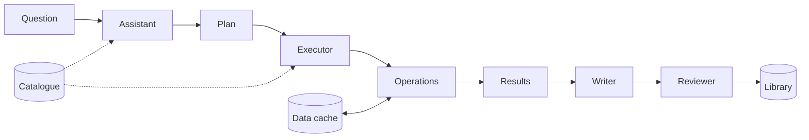

# Architecture

One repository, one container. A FastAPI process serves the API, the event stream and the built web app.
Analyses, cache and library are files in a data folder; there is no database server.

## The path of a question

| Step | What happens | Code |
| --- | --- | --- |
| Assistant | Resolves the place and reads the question. Rules and a typed pre-filter narrow the catalogue; one LLM call, when a provider is configured, writes the plan. Without a provider it works from rules | `apps/api/hup_api/assistant/` |
| Plan | A list of steps over catalogue operations, validated against the catalogue and the coverage of each source. It answers before running: `complete`, `with_limits` or `not_possible`, with an alternative question | `docs/contratos/plan.schema.json` |
| Executor | Runs the plan as a graph of steps, emits events over Server-Sent Events, caches by step, can be cancelled, and recovers analyses a previous process left running | `apps/api/hup_api/executor/` |
| Operations | Pure functions over the data layer: series, trends, anomalies, before/after contrasts against a control, break years, placebo tests, extremes, exposure, scenarios and resource estimates | `packages/hup_ops/` |
| Data layer | One reader per source, the cache with its manifest, grids, masks and place resolution. API sources are fetched for the place asked about; package sources are read from the data folder | `packages/hup_data/` |
| Results | Each result carries data or an absence with its reason, its data class, unit, period and at least one source with its URL | `docs/contratos/result.schema.json` |
| Writer | Builds the article from report blocks. Sentences have placeholders that code fills with figures; the LLM only phrases the linking text, and templates replace it when there is no provider or the budget is spent | `apps/api/hup_api/writer/` |
| Reviewer | Rules and a small model check every finding. It can lower an evidence level, never raise it, and rejects causal wording | `apps/api/hup_api/reviewer/` |
| Library | Each analysis is a folder with its question, plan, events, results and files, indexed in memory at start | `apps/api/hup_api/library/` |

## The catalogue

`catalog/` is the closed list of what the engine may use. The YAML files are the source; `catalog.json` is
built from them (`python -m hup_api.catalog build`) and is what the code and the web app read.

| File | Contents |
| --- | --- |
| `sources.yaml` | Sources with provider, resolution, access mode, account, licence and citation in English and Spanish |
| `variables.yaml` | Variables, the source and reader behind each, units, coverage and limits |
| `operations.yaml` | Operations with their parameters, version and the highest evidence level each can support |
| `chains.yaml` | Evidence chains: the links that a claim needs, each with its reference |
| `archetypes.yaml` | Resource-use archetypes for what-if estimates |
| `norms.yaml`, `legislation.yaml` | Legal thresholds quoted from their official text, and laws explained |
| `blocks.yaml` | Report blocks, what each needs and in which formats it is used |

What a person has to provide (the literal quote of a norm, the reference of a link, a consumption range) stays
empty until someone provides and checks it; the schema does not accept filler text.

## Evidence ladder

Every operation declares the highest level it can support. A result cannot exceed its operation, a finding
cannot exceed its results, and the reviewer can only lower it.

| Level | Name | Meaning |
| --- | --- | --- |
| E0 | Described | The question and the plan are described; nothing has been measured |
| E1 | Trend | A change over time, without a comparison area |
| E2 | Coincidence in time and place | The change coincides with a milestone; that is not a cause |
| E3 | Association against a control | The change stands out against a comparable area |
| E4 | Exceptional against placebos | The association holds against placebo dates and places |
| E5 | Coherent chain | Several independent lines agree; causality still needs human agreement |

## Data classes

Every figure is one of: `measured`, `reanalysis`, `extrapolated`, `approximated` or `illustrative`. The
interface shows the class next to the figure.

## Contracts

The JSON Schemas in `docs/contratos/` are the boundary between the data layer, the engine, the assistant and
the web app: catalogue, plan, event, result, analysis and cache manifest. The web app generates its types from
them. See [docs/contratos/README.md](contratos/README.md).

## Language model

One adapter (`apps/api/hup_api/llm/`) sits in front of the providers. `HUP_LLM_PROVIDER` is `openai`,
`anthropic` or `none`, with one model setting per task (plan, text, small). The adapter records the tokens and
cost of each call, and a daily budget (`HUP_LLM_DAILY_BUDGET_USD`) switches the assistant and the writer to
their rule-based paths when it is reached.

## Web app

React, TypeScript, Vite and Tailwind; MapLibre GL for maps and Observable Plot for charts. Screens: cover,
plan, run, article, data panel, report and library. Every visible string lives in `locales/`.

## Deployment

`deploy/Dockerfile` builds the web app with Node and serves everything from a Python 3.12 image. The data
folder is mounted, never baked into the image.

| Target | Files |
| --- | --- |
| Local | `deploy/compose.yaml` |
| Google Cloud Run, with the data folder on a mounted bucket | `deploy/cloudrun/service.yaml` |
| A single server behind Caddy with automatic HTTPS | `deploy/vps/` |

Limits for a public URL are environment variables: a daily LLM budget, a cap on analyses running at once and
a per-visitor rate limit. See `.env.example`.
